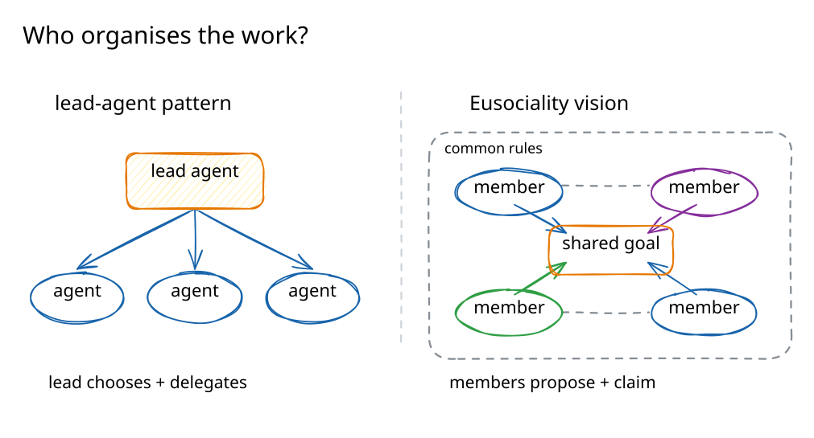
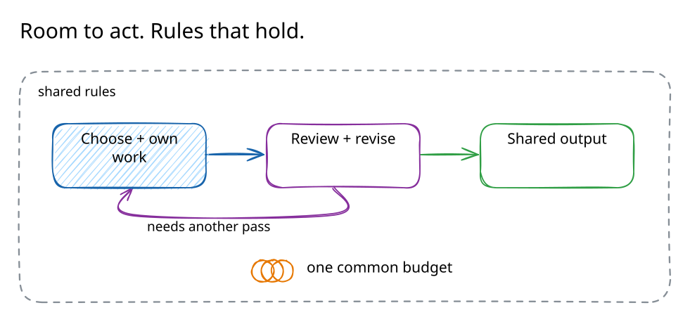
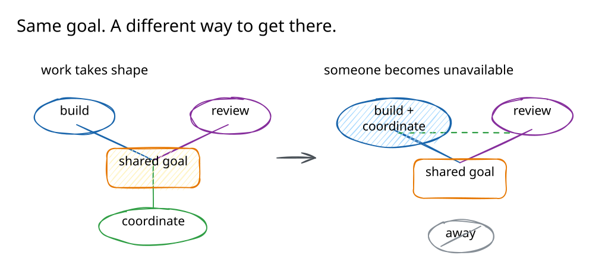

Multi-agent systems give us a way to spread work across several agents. Much of
the design is about orchestration: who receives a task, which agent acts next,
and how their outputs come together. Eusociality starts with a shared goal and
leaves more of the organisation to the agents themselves. Members decide what
work is needed and take responsibility for it within common rules.

#### How we organise agents today

A common approach puts a coordinator in charge. It breaks down a request,
delegates work, and brings the responses together. Anthropic describes this
[lead-agent pattern](https://www.anthropic.com/research/multi-agent-research-system)
in its research system. OpenAI's Agents SDK supports a similar
[manager pattern](https://openai.github.io/openai-agents-python/multi_agent/),
where a lead agent calls other agents as tools and retains control of the
conversation. The coordinator can revise its plan as it learns; the work does
not have to follow a fixed script.

There are other approaches too. Developers can define a workflow in code, or let
agents hand control to each other. OpenAI supports handoffs, and
[LangGraph Swarm](https://github.com/langchain-ai/langgraph-swarm-py) lets
specialised agents choose when to pass control to a peer. **Decentralised
coordination already exists.** A society of agents needs to deal with ownership
and shared authority as well as deciding who acts next.

#### Let the organisation take shape

The vision for Eusociality is a group whose members can propose work and choose
their contributions. The task breakdown can change as their understanding grows.
Coordination can become someone's responsibility when the group needs it, and
move elsewhere when that arrangement stops helping. **A coordinator is one
possible role within the society.**

The name comes from
[eusociality](https://en.wikipedia.org/wiki/Eusociality), the biological
organisation found in colonies such as ants and honeybees. Its definition includes
cooperative care of young and reproductive division of labour. The inspiration
here is the interdependence: separate members doing different work that sustains
something they share. For agents, the aim is an organisation that can develop
around a purpose and adjust as the work changes.

#### Shared rules, individual judgement

Members need to know what they can rely on, even when they disagree. The society
should make a few things clear:

- Who owns a piece of work, and how responsibility can move.
- How much of a shared resource the group can use.
- Whose approval is needed before work becomes part of the shared output.
- What authority comes with a responsibility, and where it ends.

**The rules should hold where decisions take effect.** Shared limits should
constrain the group, and required approval should have to happen. Within those
boundaries, members can use their own judgement about how to work. A person sets
the purpose and the boundaries, with the ability to intervene.

As the work grows, the society should be able to change its division of labour.
Members could specialise or take over responsibilities that have been left
unattended. Useful coordination should survive a change in membership without
requiring a person to redesign the whole workflow.

And this should remain visible. A person should be able to follow a proposal
through review to the work that is finally shared, see how responsibility moved,
and understand why a decision was accepted. That is the ambition for Eusociality:
an organisation that can work out how to pursue a human purpose, adapt along the
way, and remain accountable for what it does.
